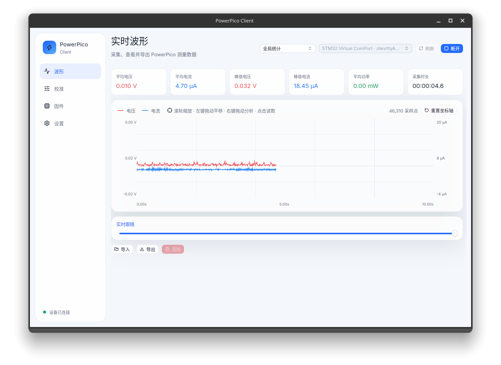
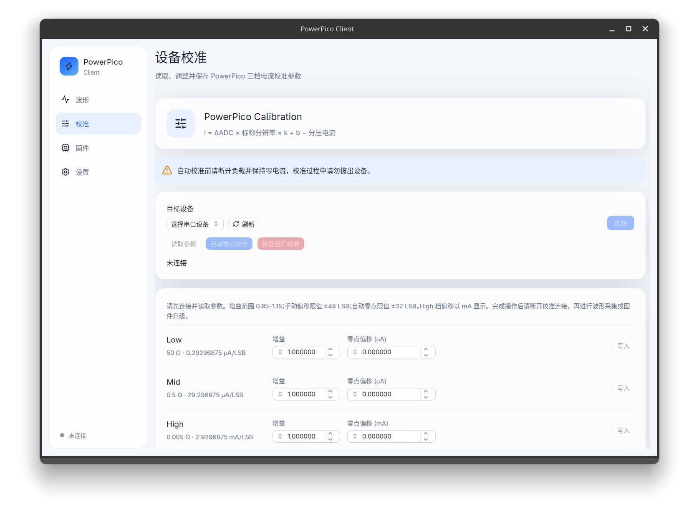
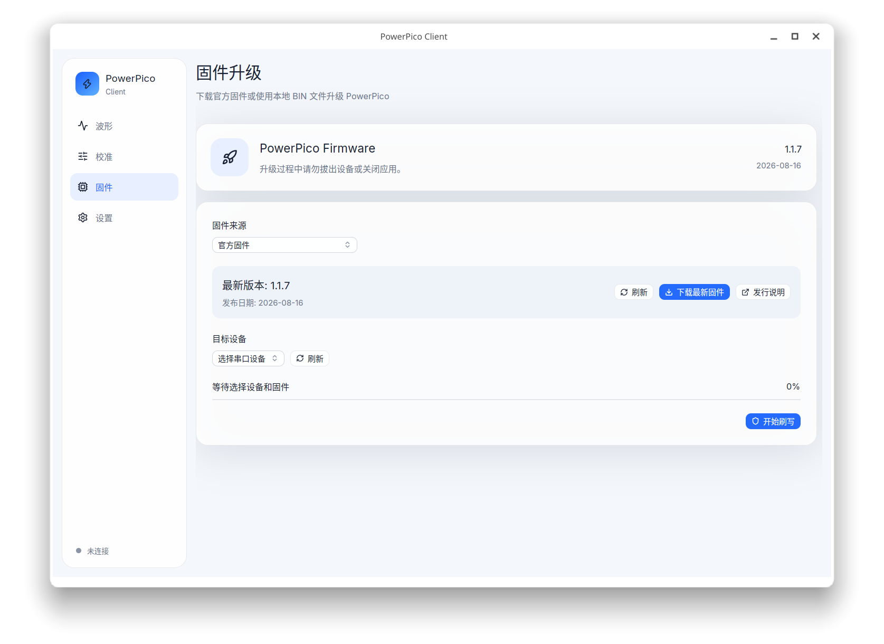

<div align="center">
  <h1 align="center">PowerPico Client</h1>
  <p align="center">面向 PowerPico 的跨平台数据采集、波形分析、校准与固件升级客户端</p>

  <a href="https://github.com/No-Chicken/PowerPicoClient_rs/releases/latest"></a>
  <a href="./LICENSE"></a>
  
  
  
  <br>
  <a href="https://github.com/No-Chicken/PowerPicoClient_rs/stargazers"></a>
</div>

---

## 📖 项目简介

**PowerPico Client** 是使用 Rust 与 [GPUI](https://www.gpui.rs) 实现的 PowerPico 桌面客户端，界面由 [GPUI Kit](https://github.com/longbridge/gpui-kit) 与 [Ely GPUI Component](https://github.com/ELY-Open-Source/Ely-GPUI-Components) 构建，提供高速数据采集、实时波形、精确区间分析、记录导入导出、三档校准、固件升级、缓存管理和客户端更新检查能力。

`GPUI` 分支已把 Tauri 2 + Svelte 前端替换为纯 Rust 实现，渲染走 GPU。迁移细节见 [从 Tauri 到 GPUI](./docs/gpui-migration.md)。

<p align="center">
  <a href="https://github.com/No-Chicken/Power-Pico">Power-Pico 主项目</a> |
  <a href="https://github.com/No-Chicken/PowerPicoClient_rs/releases/latest">下载最新版</a> |
  <a href="https://no-chicken.com/content/Power-Pico/UserManual/client_operation.html">客户端操作说明</a> |
  <a href="https://github.com/No-Chicken/PowerPicoClient_rs/issues">问题反馈</a>
</p>

<p align="center">
  
</p>

### ✨ 核心特性

- **高速采集**：1.5 Mbps 数据接收、PowerPico 协议解析、异常采样过滤和稳定设备标识。
- **实时波形**：GPU 绘制双轴曲线，支持实时跟随、历史浏览、时间/电压/电流独立缩放和平移、滚轮缩放、拖动平移、右键区间分析与原始采样点读取。
- **多级数据**：兼容原客户端 L0/L1-L5 分级记录和 LOD 波形读取，支持 BIN/CSV 导入导出。
- **统计分析**：全局、最近 10 分钟、最近 1 分钟、最近 1 秒统计，以及拖选精确区间分析。
- **设备校准**：读取三档参数、手动调整增益和零点、自动零点校准与出厂恢复；写入后回读核对，采集中应用设备保存的参数。
- **固件升级**：官方固件查询与缓存、自定义 BIN、Bootloader 重新枚举、YMODEM 刷写、进度显示和取消。
- **跨平台体验**：简体中文、繁体中文、英语、日语，浅色/深色/跟随系统主题、界面缩放和波形渲染设置。
- **维护能力**：缓存空间统计与清理、内部临时记录自动回收、平台滚动日志和更新检查。

---

## 🖼️ 功能展示

<p align="center">
  
  
</p>

<p align="center"><sub>三档电流校准与官方/自定义固件升级</sub></p>

---

## 🚀 下载与安装

请从 [GitHub Releases](https://github.com/No-Chicken/PowerPicoClient_rs/releases/latest) 下载对应平台的安装包，并使用同一 Release 中的 `SHA256SUMS` 校验文件完整性。

> 现有 Release 仍由 Tauri 版本构建。GPUI 版本的流水线只在推送 `vX.Y.Z` tag 时运行，目前产出
> Linux x86_64 压缩包；DEB/AppImage、DMG 与 NSIS 仍在补齐，见 [构建与运行](./docs/build.md#打包与发布)。

---

## 💻 平台支持

状态说明：✅ 已实现并纳入发布测试　🚧 计划支持、尚未完成　⚠️ 已实现但存在平台限制　➖ 当前不计划支持或不适用

| 功能 | macOS 11+ / Apple Silicon | Ubuntu / Debian / x86_64 | Windows / x86_64 |
| :--- | :---: | :---: | :---: |
| 数据采集与波形 | ✅ | ✅（Arch Linux 真机） | ✅ |
| 记录导入导出 | ✅ | ✅ | ✅ |
| 设备固件升级 | ✅ | ⚠️ 待真机验收 | ✅ |
| 三档校准 | ✅ | ✅（Arch Linux 真机） | ✅ |
| 缓存管理 | ✅ | ✅ | ✅ |
| 客户端更新检查 | ⚠️ 打开 Releases 页面 | ⚠️ 打开 Releases 页面 | ⚠️ 打开 Releases 页面 |

旧版 Tauri 构建的验收记录仍可作为参考：[校准功能与测试记录](./docs/calibration-testing.md)。GPUI 版本已在 Arch Linux / KDE Wayland 的 AMD 显卡、macOS 与 Windows 上完成实时采集、区间分析、记录导入导出、校准串口释放与固件升级检查；逐项清单见 [Linux 测试清单](./docs/linux-testing.md)，其他平台只需替换串口节点与数据目录。

---

## 🛠️ 开发与构建

需要 Rust 1.98+。Linux 需要 Wayland/X11、Vulkan 驱动、fontconfig 与 GTK3（文件对话框）。完整依赖清单见 [构建与运行](./docs/build.md)。

```bash
cargo run -p powerpico-app
```

发布构建：

```bash
cargo build --release -p powerpico-app
```

### 目录结构

```text
crates/core/   powerpico-core  设备、协议、采集、存储、校准、固件、网络、维护
crates/app/    powerpico-app   GPUI 窗口、四个页面、主题、i18n、波形画布
docs/          构建说明、迁移记录、校准与测试记录
```

### 质量检查

CI 只在打 tag 时运行，所以提交前请在本地跑：

```bash
cargo fmt --check
cargo clippy --workspace --all-targets -- -D warnings
cargo test --workspace
cargo build --workspace
```

### 开发辅助

| 变量 | 作用 |
| :--- | :--- |
| `POWERPICO_PAGE=waveform\|calibration\|firmware\|settings` | 启动时打开指定页面。 |
| `POWERPICO_AUTOSTART=1` | 设备就绪后自动开始采集，便于检查实时波形。 |
| `POWERPICO_THEME=light\|dark\|system` | 本次运行强制主题，便于对比两套配色。 |

### AI 编码助手技能

界面基于 GPUI Kit 与 Ely 的组件约定，仓库推荐安装 GPUI Kit 的两个技能：

```bash
npx skills add longbridge/gpui-kit
```

---

## 📂 数据与网络

设置和官方固件保存在系统应用数据目录，临时采集记录保存在应用缓存目录，日志保存在平台日志目录（与旧版路径一致）。官方固件信息来自 PowerPico 固件服务，客户端更新信息来自本仓库 GitHub Releases。

---

## 📄 许可证

Copyright (C) 2026 OpenFeastTech。

PowerPico Client 基于 [GNU General Public License v3.0 only](./LICENSE) 发布，SPDX 标识为 `GPL-3.0-only`。第三方组件声明见 [THIRD_PARTY_NOTICES.md](./THIRD_PARTY_NOTICES.md)。仓库中的旧 Python/Qt 客户端仅作为协议和行为兼容性参考，不参与本程序链接或打包。

欢迎通过 [Issues](https://github.com/No-Chicken/PowerPicoClient_rs/issues) 和 Pull Request 参与改进。
